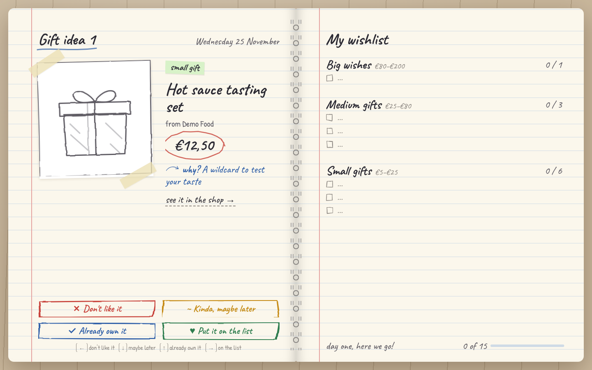
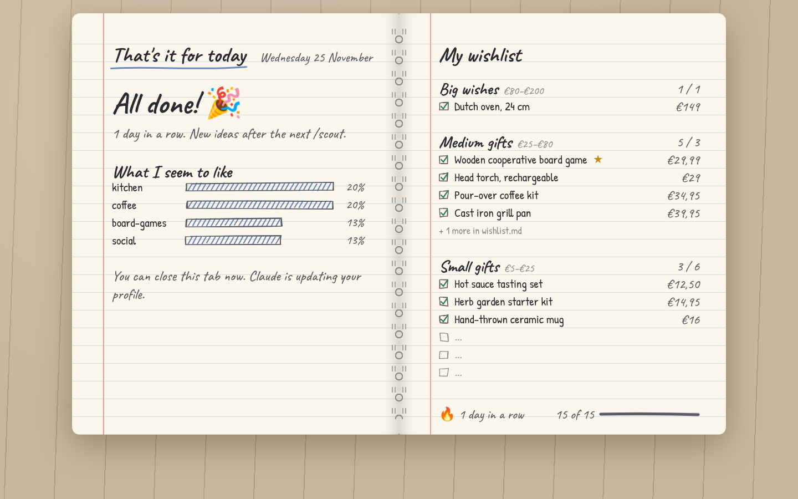

# 🎁 AI-powered gift feed

**A daily gift notebook that builds your personal birthday or Christmas wishlist, powered by Claude Code.**

Every day Claude scouts fresh gift ideas from the web, your favourite shops and Instagram gift guides.
You flip through them in a notebook in your browser for a couple of minutes: put one on the list,
save it for later, or cross it out. Every swipe teaches it your taste, so tomorrow's ideas fit better. It works like
[lootjestrekken.nl](https://www.lootjestrekken.nl/), but keeps getting more personal.

Everything runs on your own machine. Your profile and wishlist stay in plain files on your computer.



The feed is a notebook that fills your whole laptop screen. The left page shows today's gift ideas one at a
time, with the shop's own photo, and the right page is your wishlist, filling up as you go.



## Quick start

**You need:** [Claude Code](https://docs.claude.com/en/docs/claude-code/overview) with a Claude
plan, Python 3.10 or newer, and git. No other installs or accounts.

```bash
git clone https://github.com/romanvaneldijk/ai-powered-gift-feed.git
cd ai-powered-gift-feed
claude
```

Then, inside Claude Code:

1. `/setup` plays **Gift DNA**, the onboarding game (2-minute speedrun or 5-minute full game): this-or-that
   rounds, the things you use every day, your secret wishes, your taste, your no-gos and your own price ranges.
2. `/scout` finds your first deck of gift ideas.
3. `/feed` opens your gift notebook in the browser. When you finish, Claude updates your profile.

Repeat `/scout` and `/feed` each day. Want to try the notebook first? Run
`python3 app/feed.py --demo` for a demo deck. Nothing gets saved.

## Commands

| Command | What it does |
| --- | --- |
| `/setup` | The onboarding game. Saves your profile, concrete search hints for `/scout` and your price tiers. Replay one round with `/setup <round>`, for example `/setup wishes`. |
| `/scout` | Finds new gift ideas that fit your profile, checks each link and price, and adds them to your feed. |
| `/scout add-site <url>` | Adds a shop or blog you like. `/scout` checks it first on every run. |
| `/scout add-insta <url>` | Adds an Instagram gift guide post or account, or a creator's LTK page. Claude finds the products it mentions in a shop. |
| `/feed` | Today's gift notebook in your browser (→ put it on the list, ↓ kinda, maybe later, ← don't like it, ↑ already own it), then `/learn`. |
| `/learn` | Updates your likes, dislikes and "curious about" from your latest swipes. Runs after `/feed` automatically. |
| `/wishlist` | Shows your list by tier. Use `remove <id>` to drop an item, `check` to find dead links, and `export` to make a page you can share with family. |

## How it learns

- **Your own price tiers.** You choose what counts as a small, medium and big gift, and how many of
  each you want, for example 1 big wish, 3 medium and 6 small. Each deck follows those numbers and
  what your wishlist still needs, so it is never all expensive items.
- **Your choices become taste.** Each gift has tags such as `coffee`, `hiking` or `handmade`.
  "Put it on the list" pushes its tags up and "Don't like it" pushes them down. "Kinda, maybe later"
  counts a little in favour and brings the gift back on another day, at most twice. "Already own it"
  never shows the gift again, but counts in favour of its tags, because you once picked it yourself. `/learn` writes the result into
  `me/profile.md` as plain text you can read and edit.
- **It keeps exploring.** About 20% of each deck explores topics you haven't seen yet, and 10% is a
  wildcard, so your feed doesn't shrink to one hobby.
- **Bonus questions.** One quick question a day ("Tea or coffee?") sharpens the next search.

## Your data

All personal files live in `me/`, which is in `.gitignore`:

```
me/
├── settings.json   your price tiers, gift counts and deck size
├── profile.md      your taste profile (written by /setup and /learn)
├── sources.md      your favourite sites, Instagram gift guides and LTK pages
├── feed/           one JSON file per gift idea
├── pool.json       checked products waiting for a later deck
├── swipes.jsonl    every swipe
└── wishlist.md     your wishlist, grouped by tier
```

> **Keep it private.** If you fork this repo on GitHub, your fork is public. `me/` is git-ignored so
> it is never committed, but do not force-add it, and keep a private repo if you want to back it up.

## Usage and cost

There is no extra cost beyond your Claude plan. Web search and page reading in `/scout` are the
heavy part, so `/scout` keeps them small and fast:

- **A script reads the shop pages, not Claude.** `python3 app/cli.py check` reads product pages in
  parallel and pulls the title, price, stock and photo from the data shops publish for search
  engines (schema.org JSON-LD, OpenGraph tags). Claude only reads a page itself when a shop blocks
  scripts. Each shop still gets one page at a time with a pause in between, and robots.txt is honoured.
- **Shops are searched with their own search page.** `python3 app/cli.py search "koffie cadeau" …`
  turns your search hints into searches on each favourite shop's own search page and reads name,
  price, photo and link from the results, without Claude. Each shop has a small recipe
  (`app/shops.py`): Shopify shops answer a public JSON search, other shops get their results page
  read. Add your own with a `search:` URL in `me/sources.md`. Shops whose robots.txt asks scripts
  not to read search pages (such as bol.com) get a normal web search instead, and a shop's
  `Crawl-delay` is honoured.
- **Batched searches.** All searches of a round go out at once, with at most two rounds per run.
- **Nothing is read twice.** Checked products that did not make today's deck wait in `me/pool.json`
  for the next run, and shop search pages that work are remembered in `me/sources.md`.
- **Scouting while you play.** `/feed` finds the next deck while you swipe, so you rarely wait for `/scout`.

Check your own numbers with `/usage` in Claude Code.

## Good to know

- **Instagram** often blocks automated page reads. When that happens, `/scout` carries on with your
  other sources and asks you to paste the caption or drop in a screenshot of the post next time.
- **LTK pages** (shopltk.com) are read once per `/scout` run. Their product links usually lead to
  the shop, and when that shop sells in euros the card links straight to it, with the LTK page as
  credit. LTK's robots.txt blocks AI crawlers, so the page is only read on your request, one page
  at a time, and the creator's photos are never used.
- **Shops:** Claude reads single product pages at a human pace for your personal use and always
  links to the shop. Respect each site's terms.
- **Prices and stock** change over time. `/wishlist check` finds links that no longer work.

## For developers

- `app/giftfeed.py`: core logic (tiers, cards, deck, swipes, stats). Python standard library only.
- `app/shops.py`: shop search recipes for `cli.py search` (Shopify JSON search, results-page reader).
- `app/cli.py`: helper commands the slash commands call (`python3 app/cli.py -h`).
- `app/scout.py`: the fast page reader behind `cli.py check` and `cli.py links`.
- `app/feed.py` and `app/static/index.html`: the local gift notebook page.
- `.claude/commands/`: the slash commands. Edit these to change how Claude behaves.
- Tests: `python3 -m unittest discover tests`

Contributions are welcome. Please open an issue first for bigger changes.

## License

[MIT](LICENSE)
